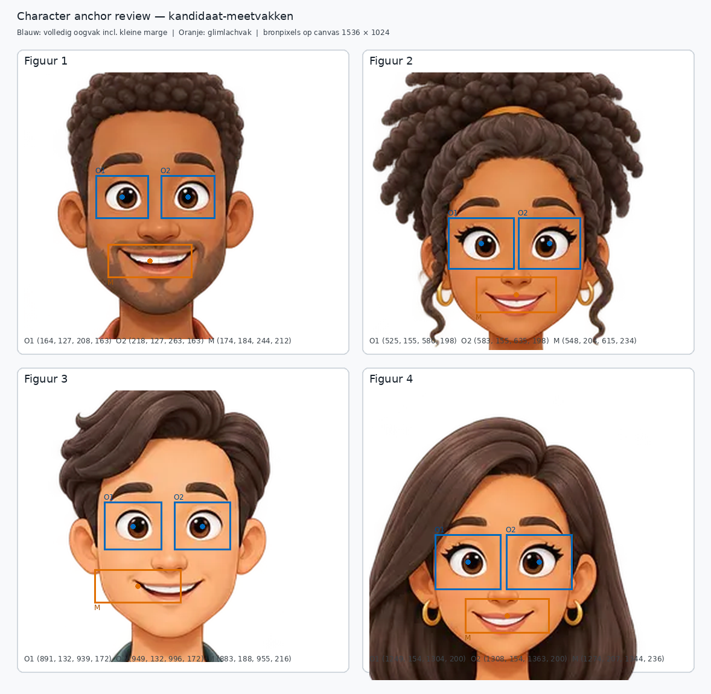

# Eerste meetreview — bestaande sprite sheet

Datum: 27 november 2026  
Status: voorlopig; niet goedgekeurd als productienorm.

## Wat is onderzocht

De aangeleverde WebP is 1536 × 1024 pixels (RGBA) en heeft SHA-256 `b3370eb60d4cea7c2b6ae601a2b5824715d7082eed6339ebc79a9bbebf7cef1a`. De hash is gelijk aan de eerder bekende Library-bron. De originele bytes zijn ongewijzigd als projectreferentie opgeslagen. De sprite sheet bevat vier figuren op één gecombineerd canvas; absolute canvascoördinaten zijn daarom géén herbruikbare ankers voor de losse personagebestanden.

De oogvakken zijn gebaseerd op de zichtbare sclera in de bron en daarna uitgebreid om iris, oogrand en wimpers te omvatten. De mondvakken zijn visueel afgelezen. De vakken zijn eerste controlemetingen, geen door de generator of een landmarkmodel vastgestelde normen.

## Voorlopige meetvakken in bronpixels

| Figuur | Linkeroogvak (x₀,y₀–x₁,y₁) | Rechteroogvak (x₀,y₀–x₁,y₁) | Glimlachvak (x₀,y₀–x₁,y₁) |
|---|---:|---:|---:|
| Figuur 1 | (164, 127, 208, 163) | (218, 127, 263, 163) | (174, 184, 244, 212) |
| Figuur 2 | (525, 155, 580, 198) | (583, 155, 635, 198) | (548, 204, 615, 234) |
| Figuur 3 | (891, 132, 939, 172) | (949, 132, 996, 172) | (883, 188, 955, 216) |
| Figuur 4 | (1249, 154, 1304, 200) | (1308, 154, 1363, 200) | (1274, 207, 1344, 236) |

De oogvakken zijn visueel gecontroleerd met de native bronresolutie; ze zijn ongeveer ±4–6 bronpixels nauwkeurig. De kandidaat-mondvakken omsluiten de zichtbare glimlach; zij zijn nog niet bewezen door een neutrale-mond-overlay.

## Wat hiermee wel en niet is vastgesteld

- Dezelfde animatiefuncties kunnen voor alle figuren worden gebruikt; alleen oog- en mondankers verschillen per afbeelding. Er is geen geslachts- of persoonsafhankelijke bewegingslogica nodig.
- Deze sprite sheet is een stijl- en houdingreferentie, geen productiebron. De vier figuren staan op één canvas en buiten de contouren zijn rode randpixels zichtbaar.
- Om productiewaarden vast te leggen, snijden we eerst één figuur uit als eigen transparante asset. Daarna meten we beide ogen apart en het mondvak relatief aan het eigen gezichtskader. De samengestelde canvascoördinaten uit deze review worden niet hergebruikt.
- Vervolgens controleren we de knippermaskers en glimlach/neutrale mond met de gedeelde rendercode op de uiteindelijke schermgrootte. Pas na die controle kunnen de verhoudingen als goedgekeurde norm dienen.

## Analyse van de eerdere blokkades en verbeteringen

1. De uitvoeromgeving was eerst niet beschikbaar en ging daarna naar `starting`. De vorige beurt stopte bij die melding in plaats van dezelfde omgeving met `wait_for_environment` af te wachten. Nu is zij `ready`; de upload was al beschikbaar en hoefde niet opnieuw te worden aangeleverd.
2. De werkruimte bevatte wel de upload maar geen lokale Git-checkout. Daardoor faalde `git status`; dat zei niets over de aanwezigheid van het bestand of de GitHub-repository. De verbetering is bestanden via de bestaande GitHub-connector op de bestaande projectbranch vast te leggen.
3. De oude `file://`-browsercontrole was door de cloudbrowserpolicy geblokkeerd. Een poging via lokale Chromium was ook niet mogelijk: `/usr/bin/chromium` verwijst naar `/opt/codex/browsers/chromium`, dat ontbreekt. De cloudbrowser kon de lokale previewserver niet bereiken (`ERR_CONNECTION_REFUSED`). De policy verbood vervolgens expliciet een andere browserroute voor hetzelfde lokale bestand. Daarom is alleen een statische annotatie gemaakt; dit geldt niet als browser- of animatievalidatie.
4. Eerdere oog- en mondankers waren geschat vanaf verkleinde previews. Meet voortaan op het originele bronbestand, controleer de vakken visueel en leg bronmaat en herkomst vast voordat overlays of nieuwe figuren worden gemaakt.
5. Bij een blokkade moet de voortgang benoemen: exacte fout, gecontroleerde fallback, resultaat en resterend punt. Geen herhaalde vraag om een bestand dat al aanwezig is en geen toezegging van een test die niet is uitgevoerd.

## Volgende stap

Beoordeel of de vakdefinities en voorlopige plaatsing visueel kloppen. Daarna kan één zelfstandig personagebeeld worden gekalibreerd en de gedeelde animatie daarop worden getest zodra een toegestane previewomgeving beschikbaar is. Er is geen nieuw personage gegenereerd.
